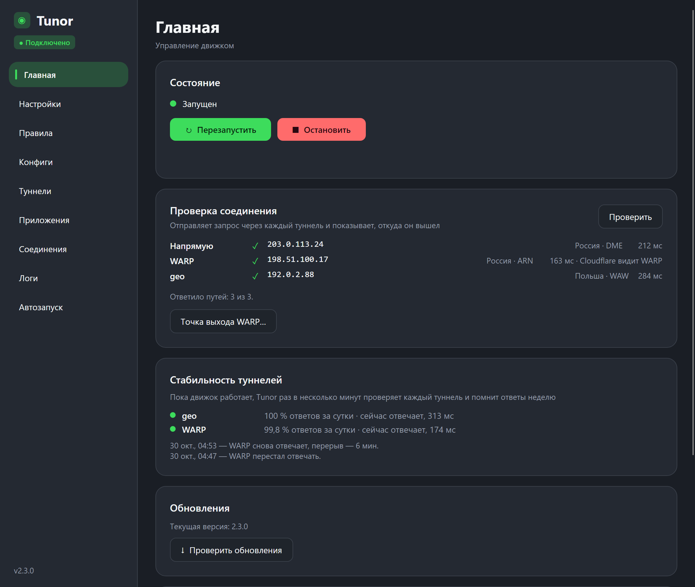
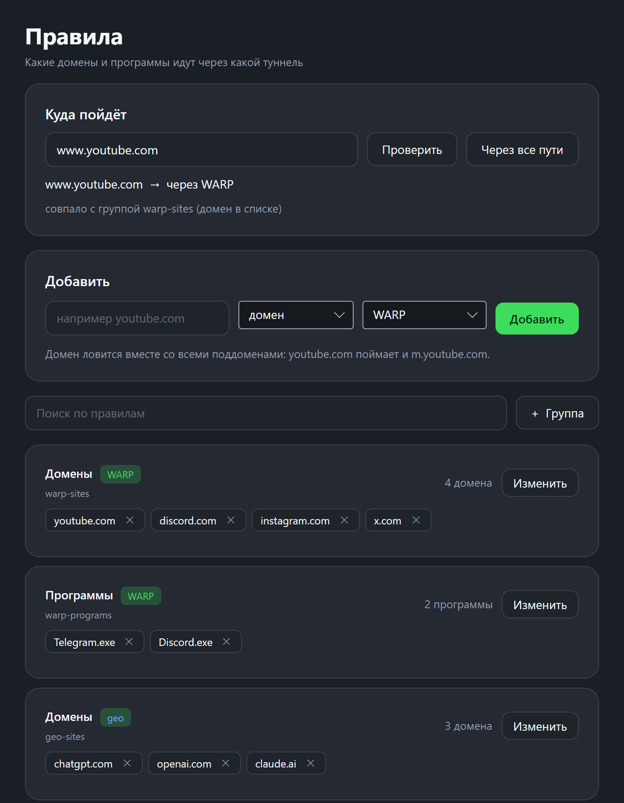
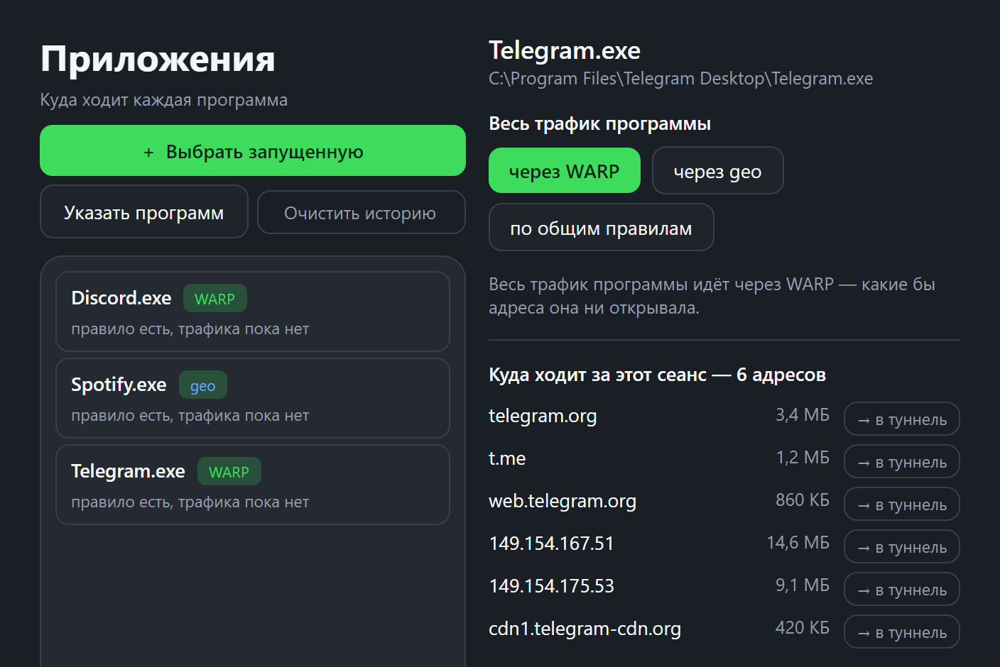
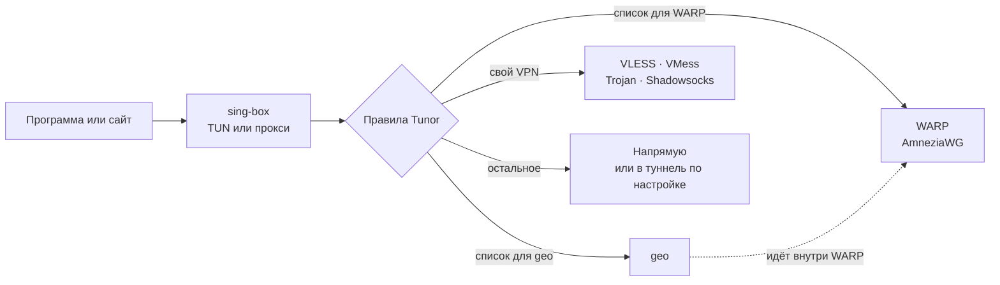

<div align="center">


# Tunor

**Нужные сайты и программы идут через туннель, остальное — напрямую.**<br>
Графический интерфейс для [sing-box](https://github.com/SagerNet/sing-box) с поддержкой **AmneziaWG 1.0 / 2.0 / 3.x**.

[](https://github.com/Vexorter42/Tunor/releases/latest)
[](https://github.com/Vexorter42/Tunor/releases)
[](https://github.com/Vexorter42/Tunor/actions/workflows/ci.yml)

[](#лицензия)

**[Скачать](#скачать)** · [Как это работает](#как-это-работает) · [Возможности](#возможности) · [Установка](#установка) · [Android](#android) · [Документация](#документация)

<sub>A Windows, macOS, Linux and Android GUI for sing-box with AmneziaWG (1.0 / 2.0 / 3.x): tunnels, routing rules, guided config generation and OTA updates.</sub>

</div>

<br>

<table>
  <tr>
    <td width="34%" valign="top"></td>
    <td width="33%" valign="top"></td>
    <td width="33%" valign="top"></td>
  </tr>
  <tr>
    <td align="center"><sub>Проверка каждого туннеля</sub></td>
    <td align="center"><sub>Правила и «Куда пойдёт»</sub></td>
    <td align="center"><sub>Программы по туннелям</sub></td>
  </tr>
</table>

## Скачать

| Система | Файл | |
|---|---|---|
| **Windows** 10 / 11, x64 | [`Tunor-Setup.exe`](https://github.com/Vexorter42/Tunor/releases/latest/download/Tunor-Setup.exe) | установщик, нужны права администратора |
| **macOS**, Apple Silicon (11+) | `Tunor-<версия>-arm64.dmg` | [или одной командой](#установка) |
| **macOS**, Intel (12+) | `Tunor-<версия>-x64.dmg` | то же |
| **Linux**, x86-64 | `Tunor-<версия>-x86_64.AppImage` | один файл на любой дистрибутив |
| **Android** 8+ | `Tunor-android-<версия>-arm64-v8a.apk` | [ранняя версия](#android) |

Файлы для компьютера — на странице [последнего релиза](https://github.com/Vexorter42/Tunor/releases/latest), APK для Android — в [релизах `android-v*`](https://github.com/Vexorter42/Tunor/releases?q=android-v). Программа обновляется сама: с компьютера и с телефона.

> До версии 1.10.0 проект назывался **Nyx**; имя сменилось из-за большого числа одноимённых проектов. Старые ссылки на репозиторий продолжают работать.

## Как это работает

Tunor собирает `config.json` из ваших туннелей и правил и запускает движок sing-box отдельным процессом. Правила решают, куда пойдёт каждый запрос; всё, что в них не названо, идёт по маршруту по умолчанию.



Туннелей может быть сколько угодно, и любой можно пустить **внутрь** другого: так geo идёт цепочкой через WARP, а свой VPN остаётся доступным там, где его адрес заблокирован.

## Возможности

<table>
  <tr>
    <td width="33%" valign="top"><b>AmneziaWG 1.0 → 3.x</b><br>Движок <a href="https://github.com/Leadaxe/sing-box-lx">sing-box-lx</a>: <code>Jc</code>, <code>S1–S4</code>, <code>H1–H4</code>, <code>I1–I5</code> и всё из 3.x.</td>
    <td width="33%" valign="top"><b>Свой VPN и подписки</b><br>VLESS, VMess, Trojan, Shadowsocks по ссылке; подписка с пингом серверов и кнопкой «самый быстрый».</td>
    <td width="33%" valign="top"><b>Сломанный не роняет остальных</b><br>Ключи и ссылки проверяются до сборки конфига; негодный туннель не попадёт в него, а приложение скажет, что с ним не так.</td>
  </tr>
  <tr>
    <td valign="top"><b>Правила и каталог</b><br>Около тридцати готовых списков (YouTube, Discord, Telegram, ChatGPT, Claude, Netflix…), свои домены и <code>.srs</code>.</td>
    <td valign="top"><b>«Куда пойдёт»</b><br>Впиши домен, ссылку, IP или программу — и увидишь путь и правило, которое сработало. «Через все пути» покажет, где именно беда.</td>
    <td valign="top"><b>Приложения</b><br>Любую программу целиком — в нужный туннель одной кнопкой. Раздел «Соединения» показывает, что идёт сейчас.</td>
  </tr>
  <tr>
    <td valign="top"><b>Проверка и диагностика</b><br>Выход напрямую и через каждый туннель, стабильность за неделю, отчёт о проблеме без ключей и адресов подписок.</td>
    <td valign="top"><b>Обучение</b><br>Шесть уроков с анимациями, вопросы и экзамен: объясняет, как работают правила и что делать, если не работает.</td>
    <td valign="top"><b>Живёт сам</b><br>Обновления по воздуху с проверкой SHA256, сторож движка, трей, автозапуск, резервная копия, при желании под паролем (AES-256).</td>
  </tr>
</table>

Полный список с подробностями — в [`docs/features.md`](docs/features.md).

## Установка

<details open>
<summary><b>Windows</b></summary>

1. Скачай **`Tunor-Setup.exe`** со страницы [Releases](https://github.com/Vexorter42/Tunor/releases/latest).
2. Запусти установщик — нужны права администратора.
3. Переходи к [первому запуску](#первый-запуск).

</details>

<details>
<summary><b>macOS</b> (Apple Silicon и Intel)</summary>

Проще всего одной командой — она скачает сборку, проверит контрольную сумму, положит рядом с собой и поставит движок:

```bash
curl -fsSL https://raw.githubusercontent.com/Vexorter42/Tunor/main/packaging/mac-install.sh | bash
```

Либо вручную: скачать **`Tunor-<версия>-arm64.dmg`** (Apple Silicon) или **`Tunor-<версия>-x64.dmg`** (Intel) из релиза и перетащить Tunor в «Программы». Для Intel нужна macOS 12 или новее: на ней работает .NET 8, на котором написана программа.

> **Важно.** Сборка подписана **ad-hoc**, а не сертификатом разработчика Apple — аккаунта за проектом нет. Поэтому при первом запуске из `.dmg` система скажет, что не смогла проверить приложение:
>
> 1. В первом окне нажми **«Готово»**.
> 2. **Системные настройки → Конфиденциальность и безопасность → «Все равно открыть»**.
> 3. Система спросит ещё раз — снова **«Все равно открыть»**. Подсвечена там кнопка «Переместить в Корзину», то есть не та.
>
> Правый клик → «Открыть» на нынешних macOS уже не помогает, Apple этот путь убрала. Установка командой выше диалога не вызывает вовсе — она снимает метку «скачано из интернета» сама.

Дальше на «Главной» нажми **«Установить службу»**: пароль спросят один раз, и после этого «Запустить» и «Остановить» работают молча. Режим TUN требует прав root, и служба держит их за приложение — без неё пароль будут спрашивать при каждом запуске.

Запускать программу **из самого образа** не надо: macOS в этом случае подменяет её временной копией в томе только для чтения, и обновиться оттуда нельзя. Приложение об этом предупредит.

Установщик и образ не содержат ничьих приватных ключей, адресов подписок и личных списков доменов — всё настраивается и скачивается на месте.

</details>

<details>
<summary><b>Linux</b> (x86-64)</summary>

Скачай **`Tunor-<версия>-x86_64.AppImage`** из релиза — это один файл, который работает на любом дистрибутиве:

```bash
chmod +x Tunor-*.AppImage
./Tunor-*.AppImage
```

Рядом лежит `.tar.gz` для тех, кому привычнее распаковать папку (запуск — `Tunor/AppRun`). Если AppImage жалуется на `libfuse.so.2` — это требование формата: `sudo apt install libfuse2t64` или `sudo pacman -S fuse2`, либо воспользуйся `.tar.gz`.

Библиотеки рабочего стола внутрь не вкладываются — они принадлежат системе, и на любой обычной графической установке уже стоят. Если запускаешь в голом окружении (контейнер, WSL, сервер без десктопа), доставь их:

```bash
# Debian / Ubuntu
sudo apt install libx11-6 libxext6 libxrandr2 libxi6 libxcursor1 libxfixes3 libice6 libsm6 libfontconfig1 libgl1 libgtk-3-0

# Arch
sudo pacman -S --needed libx11 libxext libxrandr libxi libxcursor libxfixes libice libsm fontconfig libglvnd gtk3
```

**Режим TUN** требует права поднять сетевой интерфейс. Службы, как на macOS, здесь нет — движок её на Linux не ставит. Вместо этого на «Главной» есть кнопка **«Выдать права движку»**: она один раз вешает `cap_net_admin` на сам движок, и после этого пароль не спрашивают **вовсе** — ни при запуске, ни потом. То же самое руками:

```bash
sudo setcap cap_net_admin,cap_net_raw+ep ~/.config/tunor/build/sing-box
```

Режим «только прокси» прав не требует совсем.

Скачанный AppImage — просто файл в папке загрузок, и десктоп о нём ничего не знает. На вкладке **«Автозапуск»** есть кнопка **«Добавить в меню»**: она кладёт `.desktop` в твою же папку `~/.local/share/applications`, без пароля, и так же убирается.

Файлы программа держит в `~/.config/tunor`, автозапуск — обычный user-юнит systemd (`systemctl --user status tunor`).

</details>

<details>
<summary><b>Android</b> (8.0 и новее)</summary>

Скачай **`Tunor-android-<версия>-arm64-v8a.apk`** для телефона из [релиза `android-v*`](https://github.com/Vexorter42/Tunor/releases?q=android-v) (`x86_64` нужен только эмулятору), открой его и разреши установку из этого источника. Google Play Protect может спросить, проверить ли приложение: оно не из магазина, поэтому это нормально.

Дальше приложение обновляется само: «Ещё → Обновления». Файл подписан ключом разработчика, и обновление принимается только с тем же ключом. Подробности — в [разделе про Android](#android).

</details>

### Первый запуск

1. Прими условия и пройди обучение (около трёх минут: анимации, вопросы, короткий экзамен); там же кнопка **«Скачать списки»**.
2. Сгенерируй конфиг WARP в [@warp_generator_bot](https://t.me/warp_generator_bot) (если через WARP не открывается часть сайтов, например YouTube, выбери в поле «Конечная точка» вариант «Альтернативный») и добавь его: кнопкой **«Добавить файл .conf»** на «Главной», перетаскиванием на окно или через **Ctrl+V**.
3. *(необязательно)* geo или свой VPN по ссылке — на вкладке «Туннели».
4. Нажми **«Запустить»**.

### Какую версию AmneziaWG выбирать

Движок понимает все, так что выбирай любую:

| Версия | Параметры | Поддержка |
|---|---|---|
| AWG 1.0 | `S1–S4`, `Jc`, `Jmin`, `Jmax`, `H1–H4` | ✅ |
| AWG 2.0 | `I1–I5` | ✅ |
| AWG 3.0 | padding, rekey, reject, keepalive, handshake | ✅ |
| AWG 3.1 | `RandomTrailers`, `DisableCookies` | ✅ |

## Android

Приложение для телефона на том же движке с AmneziaWG: WARP и geo (geo идёт внутри WARP), свои VPN, тот же каталог готовых списков, свои сайты.

- **Туннель для каждого приложения:** по правилам, напрямую или через нужный туннель (через туннель — с Android 10).
- **Плитка в шторке:** включить и выключить одним нажатием.
- **Сервер подписки выбирается сам:** приложение меряет серверы, а движок проверяет ближайшие настоящим запросом и обходит те, что не работают. Если ни один обычный сервер не отвечает, берутся серверы со словами «обход», «глушилка», «LTE» или «оператор».
- **Мобильная сеть: запасной путь** (включается в «Ещё»). На Wi-Fi ничего не меняется; если на мобильной сети ни WARP, ни geo не отвечают десять секунд, весь трафик идёт через такие серверы подписки, а когда обычные пути вернулись, всё как настроено.
- **Отчёты о сбоях:** если приложение упало, упал движок или туннель оборвался, Tunor записывает отчёт без ключей, адресов подписок и твоих сайтов; его можно прочитать и отправить.
- **Пинг серверов подписки** и кнопка «Быстрейший» для ручного выбора.
- **Обновление по воздуху** с проверкой подписи.

> [!NOTE]
> Это ранняя версия (0.4.x). Она проверена на эмуляторе против локальных серверов; на настоящем телефоне с настоящим WARP — ещё нет. Пока только ссылки `vless://` (без `vmess://`, `trojan://`, `ss://`), нет IPv6, обучения и запуска при включении телефона. Если что-то не так — [напишите](https://github.com/Vexorter42/Tunor/issues).

Подробности, сборка и список проверенного — в [`android/README.md`](android/README.md). Папка `android/` распространяется под GPL v3, потому что в приложение входит библиотека движка sing-box.

## Обновления

Программа сама ищет новую версию при запуске и раз в несколько часов, скачивает сборку для своей системы, сверяет `SHA256` и ставит её. Если GitHub не отвечает за 12 секунд, берётся зеркало. Файлы для компьютера лежат в релизе программы, а APK для Android — в отдельном релизе `android-v*`; в каком именно, приложению говорит общий `version.json`. Как это устроено — в [`docs/updates.md`](docs/updates.md).

## Документация

| | |
|---|---|
| [`docs/features.md`](docs/features.md) | все возможности подробно |
| [`docs/updates.md`](docs/updates.md) | как устроены обновления и манифест `version.json` |
| [`docs/development.md`](docs/development.md) | сборка из исходников, проверки, устройство репозитория, файлы на диске |
| [`packaging/README.md`](packaging/README.md) | сборка установщика для Windows |
| [`android/README.md`](android/README.md) | приложение для Android: что есть, как проверено, как собрать и выпустить |
| [`tutorial/video/README.md`](tutorial/video/README.md) | как собираются ролики из анимаций обучения |
| [`THIRD-PARTY-NOTICES.md`](THIRD-PARTY-NOTICES.md) | сторонние компоненты и их лицензии |

## Помощь

Если что-то не работает: в «Логах» есть кнопка **«Отчёт о проблеме»** — она собирает в файл версии, состояние туннелей и лог, а ключи, адреса подписок и личные списки в него не попадают, так что его можно прикладывать не читая. Дальше — [issue](https://github.com/Vexorter42/Tunor/issues).

## Поддержать

Проект развивается в свободное время. Поддержать можно здесь: **https://www.donationalerts.com/r/nick556655** ❤

## Благодарности

- [sing-box](https://github.com/SagerNet/sing-box) — основа движка.
- [sing-box-lx](https://github.com/Leadaxe/sing-box-lx) — форк с поддержкой AmneziaWG 3.x.
- [itdoginfo/allow-domains](https://github.com/itdoginfo/allow-domains) — списки правил.

## Лицензия

Исходный код Tunor (каталоги `ui/`, `core/`, `desktop/`, `smoke/`) — [MIT](LICENSE). Каталог `android/` — [GPL v3](android/LICENSE): в приложение входит библиотека движка sing-box под GPL v3.

<details>
<summary>Сторонние компоненты, отказ от аффилиации и от ответственности</summary>

### Сторонние компоненты

**sing-box** распространяется под **GNU General Public License v3 или новее**
(Copyright © 2022 nekohasekai `<contact-sagernet@sekai.icu>`) с дополнительным
условием автора:

> In addition, no derivative work may use the name or imply association
> with this application without prior consent.

В установщик вкладывается **неизменённый** исполняемый файл
`sing-box 1.14.2-lx.11` (windows-amd64, собран с тегом `with_awg`). Сборка для
macOS движок с собой не несёт: `mac-install.sh` скачивает `sing-box
1.14.2-lx.11` (darwin-arm64) из релиза sing-box-lx и сверяет его с
опубликованными там контрольными суммами. Соответствующий исходный код:

- сборка: <https://github.com/Leadaxe/sing-box-lx> — тег `v1.14.2-lx.11`
- upstream: <https://github.com/SagerNet/sing-box>

Эти ссылки остаются действующими всё время, пока распространяется данная сборка;
если они перестанут работать — откройте issue, и исходники будут предоставлены.
Полные тексты лицензий лежат в папке установки (`licenses/`) и описаны в
[`THIRD-PARTY-NOTICES.md`](THIRD-PARTY-NOTICES.md).

Tunor — **отдельная программа**: она запускает движок как самостоятельный
процесс и передаёт ему конфигурационный файл, а не линкуется с ним.

**Файлы правил (`.srs`)** из проекта
[itdoginfo/allow-domains](https://github.com/itdoginfo/allow-domains)
**не входят** в установщик — Tunor скачивает их из первоисточника по запросу
пользователя. На момент сборки лицензия в этом репозитории не указана.

### Отказ от аффилиации

Tunor не аффилирован с проектами sing-box, sing-box-lx, AmneziaWG, Cloudflare,
ProtonVPN и Apple, не одобрен ими и не поддерживается ими. Их названия
используются исключительно для описания совместимости.

### Отказ от ответственности

Программа предоставляется «как есть», без каких-либо гарантий. Автор не несёт
ответственности за любой ущерб, связанный с её использованием. Ответственность за
соблюдение законов своей страны и условий использования сторонних сервисов лежит
на пользователе.

</details>
